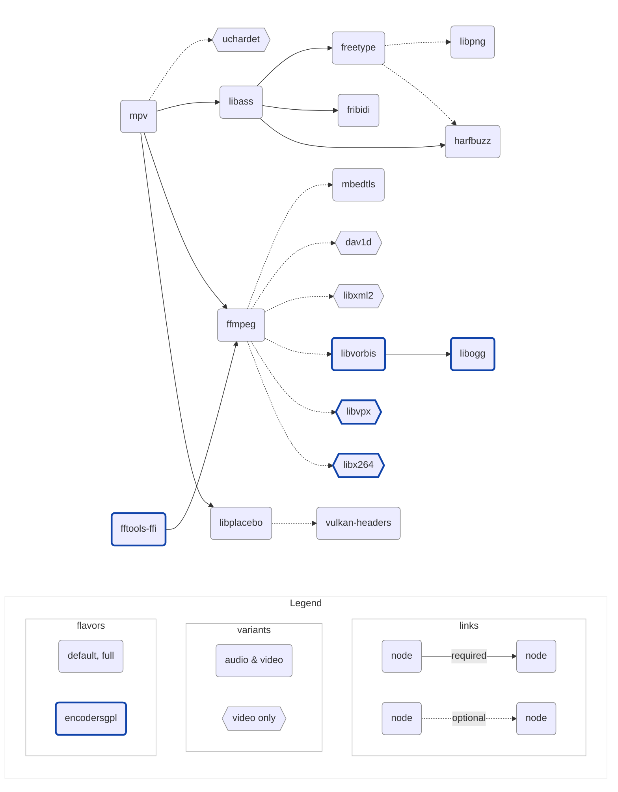

# libmpv build

Provides builds of [libmpv](https://github.com/mpv-player/mpv) for macOS & iOS,
used by [mediax](https://github.com/demoofbug/mediax), compatible with
commercial use for playback, and GPL use for encoding.

## Setup

- Nix: [nixos.org/download/#nix-install-macos](https://nixos.org/download/#nix-install-macos)
- Xcode: [./nix/overlays/xcode.nix](./nix/overlays/xcode.nix)

> [!NOTE]
> If you plan to use Nix only temporarily, prefer the
> [Determinate Systems installer](https://github.com/DeterminateSystems/nix-installer)
> which ships a built-in uninstaller, unlike the official one.

## Build

```shell
$ nix develop -c make VERSION=v0.41.0+1
$ tree result
```

<details>
<summary>result</summary>

```shell
├── libmpv-libs_v0.41.0+1_ios-arm64-audio-default.tar.gz
├── libmpv-libs_v0.41.0+1_ios-arm64-audio-full.tar.gz
├── libmpv-libs_v0.41.0+1_ios-arm64-video-default.tar.gz
├── libmpv-libs_v0.41.0+1_ios-arm64-video-full.tar.gz
├── libmpv-libs_v0.41.0+1_iossimulator-amd64-audio-default.tar.gz
├── libmpv-libs_v0.41.0+1_iossimulator-amd64-audio-full.tar.gz
├── libmpv-libs_v0.41.0+1_iossimulator-amd64-video-default.tar.gz
├── libmpv-libs_v0.41.0+1_iossimulator-amd64-video-full.tar.gz
├── libmpv-libs_v0.41.0+1_iossimulator-arm64-audio-default.tar.gz
├── libmpv-libs_v0.41.0+1_iossimulator-arm64-audio-full.tar.gz
├── libmpv-libs_v0.41.0+1_iossimulator-arm64-video-default.tar.gz
├── libmpv-libs_v0.41.0+1_iossimulator-arm64-video-full.tar.gz
├── libmpv-libs_v0.41.0+1_iossimulator-universal-audio-default.tar.gz
├── libmpv-libs_v0.41.0+1_iossimulator-universal-audio-full.tar.gz
├── libmpv-libs_v0.41.0+1_iossimulator-universal-video-default.tar.gz
├── libmpv-libs_v0.41.0+1_iossimulator-universal-video-full.tar.gz
├── libmpv-libs_v0.41.0+1_macos-amd64-audio-default.tar.gz
├── libmpv-libs_v0.41.0+1_macos-amd64-audio-full.tar.gz
├── libmpv-libs_v0.41.0+1_macos-amd64-video-default.tar.gz
├── libmpv-libs_v0.41.0+1_macos-amd64-video-full.tar.gz
├── libmpv-libs_v0.41.0+1_macos-arm64-audio-default.tar.gz
├── libmpv-libs_v0.41.0+1_macos-arm64-audio-full.tar.gz
├── libmpv-libs_v0.41.0+1_macos-arm64-video-default.tar.gz
├── libmpv-libs_v0.41.0+1_macos-arm64-video-full.tar.gz
├── libmpv-libs_v0.41.0+1_macos-universal-audio-default.tar.gz
├── libmpv-libs_v0.41.0+1_macos-universal-audio-full.tar.gz
├── libmpv-libs_v0.41.0+1_macos-universal-video-default.tar.gz
├── libmpv-libs_v0.41.0+1_macos-universal-video-full.tar.gz
├── libmpv-xcframeworks_v0.41.0+1_ios-universal-audio-default.tar.gz
├── libmpv-xcframeworks_v0.41.0+1_ios-universal-audio-default_Ass.zip
├── libmpv-xcframeworks_v0.41.0+1_ios-universal-audio-default_Avcodec.zip
├── libmpv-xcframeworks_v0.41.0+1_ios-universal-audio-default_Avfilter.zip
├── libmpv-xcframeworks_v0.41.0+1_ios-universal-audio-default_Avformat.zip
├── libmpv-xcframeworks_v0.41.0+1_ios-universal-audio-default_Avutil.zip
├── libmpv-xcframeworks_v0.41.0+1_ios-universal-audio-default_Freetype.zip
├── libmpv-xcframeworks_v0.41.0+1_ios-universal-audio-default_Fribidi.zip
├── libmpv-xcframeworks_v0.41.0+1_ios-universal-audio-default_Harfbuzz.zip
├── libmpv-xcframeworks_v0.41.0+1_ios-universal-audio-default_Mbedcrypto.zip
├── libmpv-xcframeworks_v0.41.0+1_ios-universal-audio-default_Mbedtls.zip
├── libmpv-xcframeworks_v0.41.0+1_ios-universal-audio-default_Mbedx509.zip
├── libmpv-xcframeworks_v0.41.0+1_ios-universal-audio-default_Mpv.zip
├── libmpv-xcframeworks_v0.41.0+1_ios-universal-audio-default_Png16.zip
├── libmpv-xcframeworks_v0.41.0+1_ios-universal-audio-default_Swresample.zip
├── libmpv-xcframeworks_v0.41.0+1_ios-universal-audio-default_Swscale.zip
├── libmpv-xcframeworks_v0.41.0+1_ios-universal-audio-full.tar.gz
├── libmpv-xcframeworks_v0.41.0+1_ios-universal-audio-full_Ass.zip
├── libmpv-xcframeworks_v0.41.0+1_ios-universal-audio-full_Avcodec.zip
├── libmpv-xcframeworks_v0.41.0+1_ios-universal-audio-full_Avfilter.zip
├── libmpv-xcframeworks_v0.41.0+1_ios-universal-audio-full_Avformat.zip
├── libmpv-xcframeworks_v0.41.0+1_ios-universal-audio-full_Avutil.zip
├── libmpv-xcframeworks_v0.41.0+1_ios-universal-audio-full_Freetype.zip
├── libmpv-xcframeworks_v0.41.0+1_ios-universal-audio-full_Fribidi.zip
├── libmpv-xcframeworks_v0.41.0+1_ios-universal-audio-full_Harfbuzz.zip
├── libmpv-xcframeworks_v0.41.0+1_ios-universal-audio-full_Mbedcrypto.zip
├── libmpv-xcframeworks_v0.41.0+1_ios-universal-audio-full_Mbedtls.zip
├── libmpv-xcframeworks_v0.41.0+1_ios-universal-audio-full_Mbedx509.zip
├── libmpv-xcframeworks_v0.41.0+1_ios-universal-audio-full_Mpv.zip
├── libmpv-xcframeworks_v0.41.0+1_ios-universal-audio-full_Png16.zip
├── libmpv-xcframeworks_v0.41.0+1_ios-universal-audio-full_Swresample.zip
├── libmpv-xcframeworks_v0.41.0+1_ios-universal-audio-full_Swscale.zip
├── libmpv-xcframeworks_v0.41.0+1_ios-universal-video-default.tar.gz
├── libmpv-xcframeworks_v0.41.0+1_ios-universal-video-default_Ass.zip
├── libmpv-xcframeworks_v0.41.0+1_ios-universal-video-default_Avcodec.zip
├── libmpv-xcframeworks_v0.41.0+1_ios-universal-video-default_Avfilter.zip
├── libmpv-xcframeworks_v0.41.0+1_ios-universal-video-default_Avformat.zip
├── libmpv-xcframeworks_v0.41.0+1_ios-universal-video-default_Avutil.zip
├── libmpv-xcframeworks_v0.41.0+1_ios-universal-video-default_Dav1d.zip
├── libmpv-xcframeworks_v0.41.0+1_ios-universal-video-default_Freetype.zip
├── libmpv-xcframeworks_v0.41.0+1_ios-universal-video-default_Fribidi.zip
├── libmpv-xcframeworks_v0.41.0+1_ios-universal-video-default_Harfbuzz.zip
├── libmpv-xcframeworks_v0.41.0+1_ios-universal-video-default_Mbedcrypto.zip
├── libmpv-xcframeworks_v0.41.0+1_ios-universal-video-default_Mbedtls.zip
├── libmpv-xcframeworks_v0.41.0+1_ios-universal-video-default_Mbedx509.zip
├── libmpv-xcframeworks_v0.41.0+1_ios-universal-video-default_Mpv.zip
├── libmpv-xcframeworks_v0.41.0+1_ios-universal-video-default_Png16.zip
├── libmpv-xcframeworks_v0.41.0+1_ios-universal-video-default_Swresample.zip
├── libmpv-xcframeworks_v0.41.0+1_ios-universal-video-default_Swscale.zip
├── libmpv-xcframeworks_v0.41.0+1_ios-universal-video-default_Uchardet.zip
├── libmpv-xcframeworks_v0.41.0+1_ios-universal-video-default_Xml2.zip
├── libmpv-xcframeworks_v0.41.0+1_ios-universal-video-full.tar.gz
├── libmpv-xcframeworks_v0.41.0+1_ios-universal-video-full_Ass.zip
├── libmpv-xcframeworks_v0.41.0+1_ios-universal-video-full_Avcodec.zip
├── libmpv-xcframeworks_v0.41.0+1_ios-universal-video-full_Avfilter.zip
├── libmpv-xcframeworks_v0.41.0+1_ios-universal-video-full_Avformat.zip
├── libmpv-xcframeworks_v0.41.0+1_ios-universal-video-full_Avutil.zip
├── libmpv-xcframeworks_v0.41.0+1_ios-universal-video-full_Dav1d.zip
├── libmpv-xcframeworks_v0.41.0+1_ios-universal-video-full_Freetype.zip
├── libmpv-xcframeworks_v0.41.0+1_ios-universal-video-full_Fribidi.zip
├── libmpv-xcframeworks_v0.41.0+1_ios-universal-video-full_Harfbuzz.zip
├── libmpv-xcframeworks_v0.41.0+1_ios-universal-video-full_Mbedcrypto.zip
├── libmpv-xcframeworks_v0.41.0+1_ios-universal-video-full_Mbedtls.zip
├── libmpv-xcframeworks_v0.41.0+1_ios-universal-video-full_Mbedx509.zip
├── libmpv-xcframeworks_v0.41.0+1_ios-universal-video-full_Mpv.zip
├── libmpv-xcframeworks_v0.41.0+1_ios-universal-video-full_Png16.zip
├── libmpv-xcframeworks_v0.41.0+1_ios-universal-video-full_Swresample.zip
├── libmpv-xcframeworks_v0.41.0+1_ios-universal-video-full_Swscale.zip
├── libmpv-xcframeworks_v0.41.0+1_ios-universal-video-full_Uchardet.zip
├── libmpv-xcframeworks_v0.41.0+1_ios-universal-video-full_Xml2.zip
├── libmpv-xcframeworks_v0.41.0+1_macos-universal-audio-default.tar.gz
├── libmpv-xcframeworks_v0.41.0+1_macos-universal-audio-default_Ass.zip
├── libmpv-xcframeworks_v0.41.0+1_macos-universal-audio-default_Avcodec.zip
├── libmpv-xcframeworks_v0.41.0+1_macos-universal-audio-default_Avfilter.zip
├── libmpv-xcframeworks_v0.41.0+1_macos-universal-audio-default_Avformat.zip
├── libmpv-xcframeworks_v0.41.0+1_macos-universal-audio-default_Avutil.zip
├── libmpv-xcframeworks_v0.41.0+1_macos-universal-audio-default_Freetype.zip
├── libmpv-xcframeworks_v0.41.0+1_macos-universal-audio-default_Fribidi.zip
├── libmpv-xcframeworks_v0.41.0+1_macos-universal-audio-default_Harfbuzz.zip
├── libmpv-xcframeworks_v0.41.0+1_macos-universal-audio-default_Mbedcrypto.zip
├── libmpv-xcframeworks_v0.41.0+1_macos-universal-audio-default_Mbedtls.zip
├── libmpv-xcframeworks_v0.41.0+1_macos-universal-audio-default_Mbedx509.zip
├── libmpv-xcframeworks_v0.41.0+1_macos-universal-audio-default_Mpv.zip
├── libmpv-xcframeworks_v0.41.0+1_macos-universal-audio-default_Png16.zip
├── libmpv-xcframeworks_v0.41.0+1_macos-universal-audio-default_Swresample.zip
├── libmpv-xcframeworks_v0.41.0+1_macos-universal-audio-default_Swscale.zip
├── libmpv-xcframeworks_v0.41.0+1_macos-universal-audio-full.tar.gz
├── libmpv-xcframeworks_v0.41.0+1_macos-universal-audio-full_Ass.zip
├── libmpv-xcframeworks_v0.41.0+1_macos-universal-audio-full_Avcodec.zip
├── libmpv-xcframeworks_v0.41.0+1_macos-universal-audio-full_Avfilter.zip
├── libmpv-xcframeworks_v0.41.0+1_macos-universal-audio-full_Avformat.zip
├── libmpv-xcframeworks_v0.41.0+1_macos-universal-audio-full_Avutil.zip
├── libmpv-xcframeworks_v0.41.0+1_macos-universal-audio-full_Freetype.zip
├── libmpv-xcframeworks_v0.41.0+1_macos-universal-audio-full_Fribidi.zip
├── libmpv-xcframeworks_v0.41.0+1_macos-universal-audio-full_Harfbuzz.zip
├── libmpv-xcframeworks_v0.41.0+1_macos-universal-audio-full_Mbedcrypto.zip
├── libmpv-xcframeworks_v0.41.0+1_macos-universal-audio-full_Mbedtls.zip
├── libmpv-xcframeworks_v0.41.0+1_macos-universal-audio-full_Mbedx509.zip
├── libmpv-xcframeworks_v0.41.0+1_macos-universal-audio-full_Mpv.zip
├── libmpv-xcframeworks_v0.41.0+1_macos-universal-audio-full_Png16.zip
├── libmpv-xcframeworks_v0.41.0+1_macos-universal-audio-full_Swresample.zip
├── libmpv-xcframeworks_v0.41.0+1_macos-universal-audio-full_Swscale.zip
├── libmpv-xcframeworks_v0.41.0+1_macos-universal-video-default.tar.gz
├── libmpv-xcframeworks_v0.41.0+1_macos-universal-video-default_Ass.zip
├── libmpv-xcframeworks_v0.41.0+1_macos-universal-video-default_Avcodec.zip
├── libmpv-xcframeworks_v0.41.0+1_macos-universal-video-default_Avfilter.zip
├── libmpv-xcframeworks_v0.41.0+1_macos-universal-video-default_Avformat.zip
├── libmpv-xcframeworks_v0.41.0+1_macos-universal-video-default_Avutil.zip
├── libmpv-xcframeworks_v0.41.0+1_macos-universal-video-default_Dav1d.zip
├── libmpv-xcframeworks_v0.41.0+1_macos-universal-video-default_Freetype.zip
├── libmpv-xcframeworks_v0.41.0+1_macos-universal-video-default_Fribidi.zip
├── libmpv-xcframeworks_v0.41.0+1_macos-universal-video-default_Harfbuzz.zip
├── libmpv-xcframeworks_v0.41.0+1_macos-universal-video-default_Mbedcrypto.zip
├── libmpv-xcframeworks_v0.41.0+1_macos-universal-video-default_Mbedtls.zip
├── libmpv-xcframeworks_v0.41.0+1_macos-universal-video-default_Mbedx509.zip
├── libmpv-xcframeworks_v0.41.0+1_macos-universal-video-default_Mpv.zip
├── libmpv-xcframeworks_v0.41.0+1_macos-universal-video-default_Png16.zip
├── libmpv-xcframeworks_v0.41.0+1_macos-universal-video-default_Swresample.zip
├── libmpv-xcframeworks_v0.41.0+1_macos-universal-video-default_Swscale.zip
├── libmpv-xcframeworks_v0.41.0+1_macos-universal-video-default_Uchardet.zip
├── libmpv-xcframeworks_v0.41.0+1_macos-universal-video-default_Xml2.zip
├── libmpv-xcframeworks_v0.41.0+1_macos-universal-video-full.tar.gz
├── libmpv-xcframeworks_v0.41.0+1_macos-universal-video-full_Ass.zip
├── libmpv-xcframeworks_v0.41.0+1_macos-universal-video-full_Avcodec.zip
├── libmpv-xcframeworks_v0.41.0+1_macos-universal-video-full_Avfilter.zip
├── libmpv-xcframeworks_v0.41.0+1_macos-universal-video-full_Avformat.zip
├── libmpv-xcframeworks_v0.41.0+1_macos-universal-video-full_Avutil.zip
├── libmpv-xcframeworks_v0.41.0+1_macos-universal-video-full_Dav1d.zip
├── libmpv-xcframeworks_v0.41.0+1_macos-universal-video-full_Freetype.zip
├── libmpv-xcframeworks_v0.41.0+1_macos-universal-video-full_Fribidi.zip
├── libmpv-xcframeworks_v0.41.0+1_macos-universal-video-full_Harfbuzz.zip
├── libmpv-xcframeworks_v0.41.0+1_macos-universal-video-full_Mbedcrypto.zip
├── libmpv-xcframeworks_v0.41.0+1_macos-universal-video-full_Mbedtls.zip
├── libmpv-xcframeworks_v0.41.0+1_macos-universal-video-full_Mbedx509.zip
├── libmpv-xcframeworks_v0.41.0+1_macos-universal-video-full_Mpv.zip
├── libmpv-xcframeworks_v0.41.0+1_macos-universal-video-full_Png16.zip
├── libmpv-xcframeworks_v0.41.0+1_macos-universal-video-full_Swresample.zip
├── libmpv-xcframeworks_v0.41.0+1_macos-universal-video-full_Swscale.zip
├── libmpv-xcframeworks_v0.41.0+1_macos-universal-video-full_Uchardet.zip
└── libmpv-xcframeworks_v0.41.0+1_macos-universal-video-full_Xml2.zip
```

</details>

## Build a specific target

```shell
$ nix flake show
$ nix develop -c make TARGET=mk-out-archive-libs-macos-universal-video-default
$ tree result
```

## Naming convention

```
libmpv-<format>_<version>_<os>-<arch>-<variant>-<flavor>[_<framework>].<extension>
```

| Component     | Notes                                     | Value                      |
| ------------- | ----------------------------------------- | -------------------------- |
| **format**    | Output format of built files              | libs, xcframeworks         |
| **version**   | Engine version + build number ([Versioning](#versioning)) | v0.41.0+1, …               |
| **os**        | Operating system                          | ios, iossimulator, macos   |
| **arch**      | Architecture                              | arm64, amd64, universal    |
| **variant**   | Usage context                             | audio, video               |
| **flavor**    | Available decoders and encoders           | default, full, ~~encodersgpl~~ (not built, see below) |
| **framework** | SwiftPM binary target artifact (optional) | Mpv, Avcodec, Avformat, …  |
| **extension** | Packaging format                          | tar.gz, zip                |

Inclusion:

- Variants: $audio \subset video$
- Flavors: $audio \subset full \subset encodersgpl$ — the **encodersgpl**
  flavor is currently not built (see [Version history](#version-history)); the
  flavor code is kept for upstream alignment

## Versioning

Releases are tagged as:

```
v<engine-version>+<build-number>
```

- **engine-version** is the exact upstream version of the primary engine built
  by this repository (currently mpv), copied verbatim — including any
  pre-release suffix it may carry (`-rc1`, `-beta`, …).
- **build-number** is a counter owned by this repository, starting at `1`,
  incremented on every rebuild of the same engine version.

`-` is never used as a separator, because upstream versions already use it for
pre-release suffixes. The two parts can therefore always be split unambiguously
at `+` (semver build metadata).

| Change                                              | Version transition            |
| --------------------------------------------------- | ----------------------------- |
| First build of mpv `0.41.0`                         | `v0.41.0+1`                   |
| Dependency / patch / build-config change            | `v0.41.0+1` → `v0.41.0+2`     |
| Engine upgrade (`0.41.0` → `0.42.0` or `0.41.1`)    | `v0.42.0+1` / `v0.41.1+1`     |
| Engine pre-release (`0.42.0-rc1`)                   | `v0.42.0-rc1+1`               |

Rules:

- The full tag string (e.g. `v0.41.0+1`) is the single source of truth. On a
  tag build, CI writes it into `.nix/config/version.txt`, from where it flows
  into artifact names (see [Naming convention](#naming-convention)). Parts are
  derived from the tag, never maintained separately.
- Framework `Info.plist` keys are derived as well:
  `CFBundleShortVersionString` = engine version (`0.41.0`, taken from
  `packages.lock.nix` — the version actually built, so a mistyped tag cannot
  poison it), `CFBundleVersion` = build number (`1`, from the tag's `+N`
  suffix; `0` for non-tag builds), and a custom `MediaXFullVersion` key =
  full version string (`v0.41.0+1`) for runtime diagnostics. Apple only
  accepts digits and periods in the two standard keys, which is why `+` must
  never appear in them (custom keys are not validated and may contain it).
- Non-tag builds fall back to the committed `develop` version string.
- Pushing a tag triggers CI, which builds all targets and publishes them to a
  GitHub Release named after the tag.

## Version history

### Unreleased

- Upgraded **mpv** `0.36.0` → `0.41.0`:
  - Added **libplacebo** `7.360.1` — a hard dependency of mpv since `0.37`
    (the GPU render pipeline, including libmpv's `render_gl` API, is built on
    it).
  - Added **vulkan-headers** `1.3.290` — headers-only, required by
    libplacebo's meson setup; the Vulkan backend itself is disabled on Apple
    platforms (OpenGL + VideoToolbox).
  - Dropped mpv meson options removed upstream (`libplacebo`, `stdatomic`,
    `rpi`, `rpi-mmal`, `vaapi-x-egl`, `sdl2`, `ta-leak-report`), renamed
    `win32-internal-pthreads` → `win32-threads`, and updated the macOS SDK
    feature options to their new names.
  - Rewrote `mpv-audiounit-shared-session.patch` against `0.41.0` (upstream
    reworked the `AVAudioSession` handling in `ao_audiounit.m`).
  - Removed `mpv-fix-missing-objc.patch` and `mpv-remove-libass.patch` —
    neither applies against `0.41.0`; libass is now linked in the audio
    variant instead of being stripped out.
- Upgraded **ffmpeg** `6.0` → `9.0.2` (mpv `0.41.0` requires
  libavutil ≥ 58.29.100):
  - Removed `ffmpeg-fix-vp9-hwaccel.patch`,
    `ffmpeg-fix-hls-mp4-seek.patch` and
    `ffmpeg-fix-dash-base-url-escape.patch` — none of them applies against
    the ffmpeg 9 source tree.
  - Dropped `--enable-protocol=hls` from the configure whitelist (the
    protocol was removed in ffmpeg 9; HLS playback goes through the demuxer).
  - The **encodersgpl** flavor is disabled in the build matrix
    (`nix/utils/default/flavors.nix`) — this repository ships playback-only
    LGPL builds. The flavor code is kept for upstream alignment; note that
    fftools-ffi does not compile against the ffmpeg 9 API, so the flavor
    needs a port before it can be re-enabled.
- Packaging: `mk-out-libs` now bundles libass with its font stack (freetype,
  harfbuzz, fribidi, libpng) in the audio variant too. libplacebo is linked
  statically into libmpv (meson default) and does not ship as a separate
  dylib/framework.

## Minimum versions

<table>
  <thead>
    <tr>
      <th>Platform</th>
      <th>Arch</th>
      <th>Min Version</th>
      <th>Notes</th>
    </tr>
  </thead>
  <tbody>
    <tr>
      <td rowspan="2"><strong>macOS</strong></td>
      <td>amd64</td>
      <td rowspan="2"><code>10.9</code></td>
      <td rowspan="2">Required by <code>uchardet</code></td>
    </tr>
    <tr>
      <td>arm64</td>
    </tr>
    <tr>
      <td><strong>iOS</strong></td>
      <td>arm64</td>
      <td><code>9.0</code></td>
      <td>Required by <code>ffmpeg</code></td>
    </tr>
    <tr>
      <td rowspan="2"><strong>iOS Simulator</strong></td>
      <td>amd64</td>
      <td><code>9.0</code></td>
      <td>Required by <code>ffmpeg</code></td>
    </tr>
    <tr>
      <td>arm64</td>
      <td><code>12.0</code></td>
      <td>Required by <code>xcodebuild -create-xcframework</code></td>
    </tr>
  </tbody>
</table>

## Dependencies



- [**mpv**](https://github.com/mpv-player/mpv): A free (as in freedom) media
  player for the command line. It supports a wide variety of media file formats,
  audio and video codecs, and subtitle types

- [**ffmpeg**](https://ffmpeg.org): A cross-platform solution for converting,
  streaming, and recording audio and video, with support for a wide range of
  codecs and formats

- [**fftools-ffi**](https://github.com/moffatman/fftools-ffi): FFmpeg's
  command-line interface exposed as a shared library for FFI usage (not built
  since the ffmpeg 9 upgrade — upstream does not compile against the ffmpeg 9
  API yet)

- [**libass**](https://github.com/libass/libass): A library for rendering
  subtitles in videos, with support for advanced text formatting and
  positioning features (linked in all variants since the mpv `0.41.0`
  upgrade)

- [**libplacebo**](https://github.com/haasn/libplacebo): A video rendering
  and processing library — shader management, color management, tone mapping
  and high-quality scaling. A hard dependency of mpv since `0.37`: libmpv's
  GPU render pipeline (including the `render_gl` API) is built on it

- [**vulkan-headers**](https://github.com/KhronosGroup/Vulkan-Headers):
  Headers-only Vulkan API package from Khronos. Required at configure time by
  libplacebo's meson setup; the Vulkan backend itself is disabled on Apple
  platforms, which render through OpenGL + VideoToolbox

- [**fribidi**](https://github.com/fribidi/fribidi): A library for handling
  bidirectional text (such as Arabic or Hebrew) in Unicode strings, with support
  for complex shaping and layout

- [**freetype**](https://sourceforge.net/projects/freetype/): A library for
  rendering high-quality text in graphics applications, with support for a wide
  range of font formats and glyph rendering techniques

- [**harfbuzz**](https://github.com/harfbuzz/harfbuzz): A library for shaping
  and laying out text in multiple languages and scripts, with support for
  advanced typography features such as ligatures and kerning

- [**libpng**](https://github.com/pnggroup/libpng): A library for reading and
  writing PNG (Portable Network Graphics) images, providing efficient image
  compression and lossless data handling

- [**dav1d**](https://code.videolan.org/videolan/dav1d): A library for
  cross-platform AV1 decoding

- [**libogg**](https://github.com/xiph/ogg): Reference implementation of the Ogg
  media container

- [**libvorbis**](https://github.com/xiph/vorbis): Reference implementation of
  the Ogg Vorbis audio format

- [**libvpx**](https://gitlab.freedesktop.org/gstreamer/meson-ports/libvpx):
  Reference implementation of the VP8 and VP9 video formats

- [**libx264**](https://www.videolan.org/developers/x264.html): Free software
  library for encoding video streams into the H.264/MPEG-4 AVC compression
  format

- [**mbedtls**](https://github.com/Mbed-TLS/mbedtls): An open source, portable,
  easy to use, readable and flexible TLS library

- [**libxml2**](http://xmlsoft.org/): A library for processing XML data, used by
  ffmpeg to support the Dash protocol

- [**uchardet**](https://www.freedesktop.org/wiki/Software/uchardet/): A C++
  port of the Universal Character Encoding Detector (used by Mozilla Firefox
  and Thunderbird) for detecting the encoding of input text

## Commercial use

### Default, Full flavors

| Dependency | Licence                                                | Commercial use |
| ---------- | ------------------------------------------------------ | :------------: |
| mpv        | LGPL-2.1 (`-Dgpl=false`)                               |       ✅       |
| ffmpeg     | LGPL-3.0 (`--enable-version3`, `--enable-gpl` & `--enable-nonfree` omitted) |       ✅       |
| libass     | ISC                                                    |       ✅       |
| libplacebo | LGPL-2.1                                               |       ✅       |
| vulkan-headers | Apache-2.0 / MIT                                   |       ✅       |
| freetype   | FreeType                                               |       ✅       |
| harfbuzz   | MIT                                                    |       ✅       |
| fribidi    | LGPL-2.1                                               |       ✅       |
| libpng     | zlib/libpng                                            |       ✅       |
| mbedtls    | Apache 2.0                                             |       ✅       |
| uchardet   | MPL-1.1, GPL-2, LGPL-2.1                               |       ✅       |
| libxml2    | MIT                                                    |       ✅       |
| dav1d      | BSD-2-clause                                           |       ✅       |

### Encoders-GPL flavor

> Currently **not built** — disabled in the build matrix since the ffmpeg 9
> upgrade (fftools-ffi does not compile against the ffmpeg 9 API). The table
> below describes the flavor as it will ship once re-enabled.

| Dependency  | Licence                              | Commercial use |
| ----------- | ------------------------------------ | :------------: |
| mpv         | LGPL-2.1 (`-Dgpl=false`)             |       ✅       |
| ffmpeg      | GPL-3.0 (`--enable-gpl` `--enable-version3`, `--enable-nonfree` omitted) |       ❌       |
| libass      | ISC                                  |       ✅       |
| libplacebo  | LGPL-2.1                             |       ✅       |
| vulkan-headers | Apache-2.0 / MIT                  |       ✅       |
| freetype    | FreeType                             |       ✅       |
| harfbuzz    | MIT                                  |       ✅       |
| fribidi     | LGPL-2.1                             |       ✅       |
| libpng      | zlib/libpng                          |       ✅       |
| mbedtls     | Apache 2.0                           |       ✅       |
| uchardet    | MPL-1.1, GPL-2, LGPL-2.1             |       ✅       |
| libxml2     | MIT                                  |       ✅       |
| dav1d       | BSD-2-clause                         |       ✅       |
| fftools-ffi | LGPL-2.1                             |       ✅       |
| libx264     | GPL-2.0+                             |       ❌       |
| libvpx      | BSD-3-clause                         |       ✅       |
| libvorbis   | BSD-3-clause                         |       ✅       |
| libogg      | BSD-3-clause                         |       ✅       |

## Notes

- Some dependencies, which are not needed at the moment, may be added in the
  future:
  - [**libbluray**](https://code.videolan.org/videolan/libbluray): A library for
    reading and parsing Blu-ray discs, with support for advanced features such
    as BD-J menus and seamless branching

  - [**libarchive**](https://github.com/libarchive/libarchive): A library for
    reading various archive formats, including tar and zip, with support for
    compression and metadata, and a flexible API for reading and extracting
    archive contents

- We use `meson` as much as possible in order to simplify cross-compilation, at
  the cost of some heaviness regarding legacy packages

## Resources

- https://github.com/stps/mpv-ios-scripts
- https://github.com/iina/homebrew-mpv-iina
- https://github.com/mpv-android/mpv-android
- https://github.com/jnozsc/mpv-nightly-build
- https://github.com/smplayer-dev/mpv
- https://github.com/smplayer-dev/smplayer
- https://github.com/ldwardx/mpv-build-mac-iOS
- https://github.com/birros/godot_tl/tree/ca2fc4151bd8141241151dd6e29768608600473a/toolchains
- https://github.com/Vargol/ffmpeg-apple-arm64-build
- https://github.com/arthenica/ffmpeg-kit

## Credits

This repository is a fork of [media-kit/libmpv-darwin-build](https://github.com/media-kit/libmpv-darwin-build).
